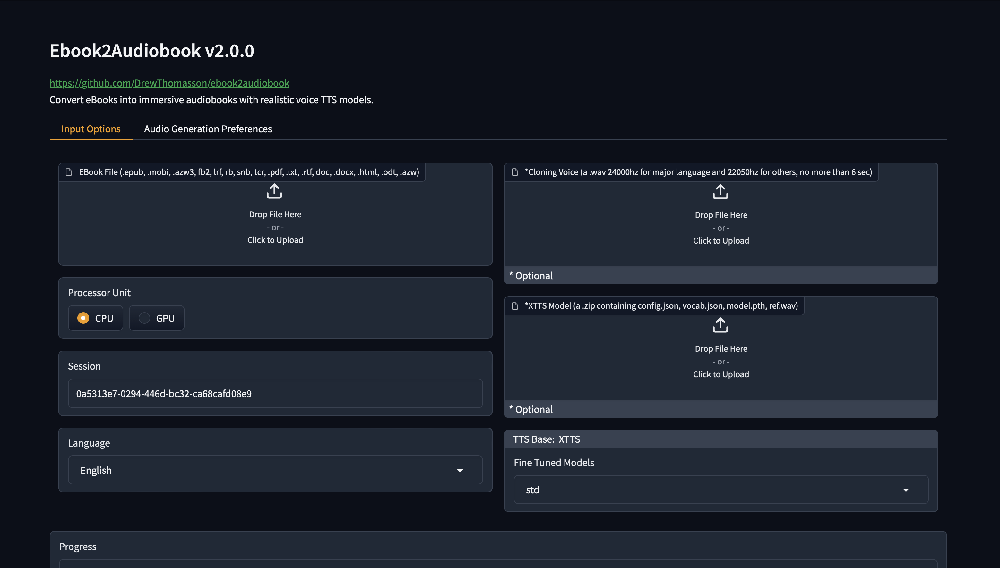
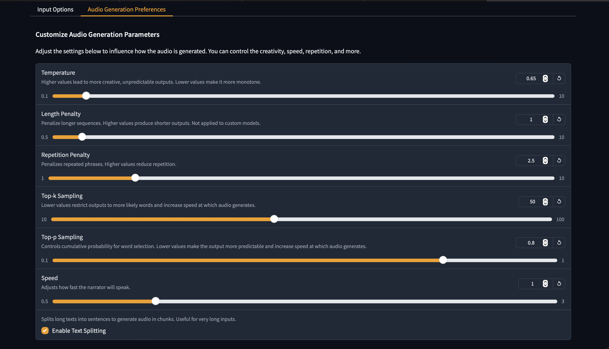
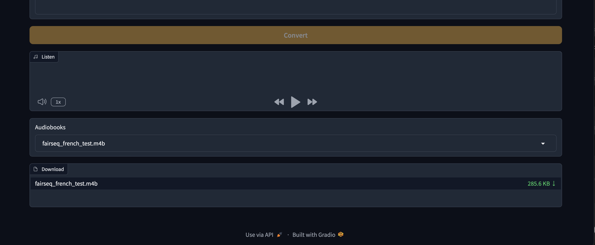

<a id="ebook2audiobook"></a>
# 📚 ebook2audiobook (E2A)
<a href="https://trendshift.io/repositories/12252?utm_source=repository-badge&amp;utm_medium=badge&amp;utm_campaign=badge-repository-12252" target="_blank" rel="noopener noreferrer"></a>

CPU/GPU Converter from E-Book to audiobook with chapters and metadata<br/>
using advanced TTS engines and much more.<br/>
Supports voice cloning and 1696 languages!
> [!IMPORTANT]
**This tool is intended for use with non-DRM, legally acquired eBooks only.** <br>
The authors are not responsible for any misuse of this software or any resulting legal consequences. <br>
Use this tool responsibly and in accordance with all applicable laws.

[](https://discord.gg/63Tv3F65k6)

### Thanks to support ebook2audiobook developers!
[](https://ko-fi.com/athomasson2) 
[![Job-Currency](https://img.shields.io/badge/Job--Currency-28A745?style=for-the-badge&logo=data:image/png;base64,iVBORw0KGgoAAAANSUhEUgAAANgAAADYCAYAAACJIC3tAAAgAElEQVR4nO2d328bR5bvv9VNUiZNqSnKtqSYsmTZ8dpJ1tYgDhANdq61NzAWmPsQ5eW+RnYC5HG0f8Fo/oLVPhqwJe3rfRnNwx3gIhiscmdhDxAvhvYksdY/JCqiLMm2aLZIkyZFdu1Ds2XqF7uqu0l2k/UBAkVy/yjZ9eU5dc6pUwSChkNTt5RswT8CAJpGxt79AYYoMGTn2QRIgCBhfC9JdAEAOvtvfmfnuQJrkGYPoJXJrM9c00pkBARDFBgBEIH+tZksAAAhWCCUJiTQeDj21YMmj6llEQJzAMMiaRoZoxpGQDCE5guJlzgB4qCISz4aFxbPGYTALEBTt5RMzj9OQUYoMA6bbp2LSRCCOQIa7zp98w/NHowXEQJjJLM+c03TyBilmEDrCsqMuAQ6LdxKdoTAapB/fnuwqMmTlGICBJFmj8dlJAjFdNfx4hyJfqM2ezBuRQhsH9nknStlSJOUYlyIipkEIZgLkPJc8L2vV5o9GDchBFYhsz5zrVwm0/BecMJdUMx3yOVJITSdthdYZn3mWrlEJkEw3uyxtAwUaUIwL0Obbve1WtsKbDs586UGMoX2DVg0igWJ0Ol2jUK2lcBo6pay/SYwQQkm0WRhFQpAsUhQLOpfASCXB8ple/8kgQBFR0D//2CQQpYrP+uwO2LbJCTQqa7YzX9r9kAaSdsIrBkWyxBRNkt2xZN3QERWCQQoAgH9ayhIEQzqIvT5GjqMuEToVLtYtJYXWCV4MYcGCCuT0QWUVqWmComXQIAiGKSIKPrXUKghr12QZTrV6hUj3pgBFsg/vz1Y0OQ5AGP1ekc6TZDPE6RV/WsrEQ5TdIYpFEWrr+BaPOrYWrMClXVWPjBJKaacfnapBKgqwVZK2rN2anWCQYpAgKInShGJ0Lq8gxBMdQWL062WtG6pGbK9NvO5ppE5JxPEpRKQShHk8gSqSjzj9tWLQIBCUfQ1XE+P42JLyDKdaCW3sSVmS/757cFCWZ52MpeVyRBspQhSKcmpR7YcskwRjVKcOqk5GqUkwHRAKk+3gtvoeYGpq7O/ocCUU1arUABevJSQSglrxUogoIssGnUwIkmRJsCUMnDjXx16YlPw7AyiqVuK+iYw55TVymQIXrwkUFVhsewQjWro73PQolHMK8eLE15dm3lSYNnknSslSPNwIPSeyRCsb0jIZj35V+FaFEUXmiMRSIq0j2hjXiy78tysUtdmf+tEhFAIqzE4adEIwZRy+sbv7D+pcXhmdtHULWU7F5imwISd5xQKQHJNEq5gg4lGNcROa06s0RaUUHHcKy6jJwRWSRovwIZLWCoBL19KWN8Qwmom/X0aTp60KTQPuYyuF9h2cuZLjZJpO1HCdJpg5WdJRAVdQiBAMXhGQ2envTyaBDrh9uJhV8+4SoHunNX7CwVg5WdZrLNcSjhMMXimbGt9RoA5JXbjhnOjchbXzjw1OTtrZ7314oUexKi31Qp3dcPnD9T1HY2mtFNEdvt1Q94lyxT9fRpOnbJlzVy7LnOlwNLJ2X+HxSLdUglY+blxQYyR0evo7ultyLsaxeutTcTvfdvQd4bDFMNny3bWZnElVBxzm8hcteKnqVtKOjn7V1gUVzpN8ONPsogQepBsVv+3S6ctf+aPqLlAPP/89qCT47KLa2YiTd1S1FxgARabziRWJCwtyyKQ4WHKZYKlZRnPlixPy6FCWY5nk3euODkuO7hCYPnntwetiqtQAB4/kUVRbguhqhIeLcrI5SzcTBApUWkhsz5zzfGBWaDps7Iqx8UtrkyGYPG/RJSwFcnnCZ48tegyEkTKJTK/vTbzufMj46OpAqOpW4rVBPLWlv4PIFzC1sVwGdfXLUxTgoimkblmW7KmCaxqzTXEe29iRcLKz7LTQxK4lPUNCYkVCaUS540VS9bMNVlTBGYnoPFsSRLrrTYklZLw5KlsSWQlKi00S2QN96+siqtUAp48lV3XXMbJRPP5Dz5GpxK1fH9GTeHpT/9pexyNTDTzEghQvH/eQvVHk+oXG9oRr9XEBcDRiVgq7di+P7216dBo3EmxqAe23j9f5ttrVrFk+ee3RxrZiqChvpYVcRUK7hWXoDmUy3qAK5PhnBMEkYImL9DULaU+IztIwwSmJmdnIcQlcAg9wihZCeMPVT7oG0JDBGalcNdwC9ul96CAn3JZ34bEbcmAkUq9a92pu8C2kzNfCnEJ6oVhySxUfYypydl/qcOQ9lBXgW2vzXzOu5/LzQENgTsx1mS8IqPA5HZy5sv6jEqnbgLLJu9c0TQhLkFjsCoyDWSunjmyugiMpm4pJUhcLayFuAR2MUTGm4wuQZqvV2SxLgLbzgW4zzoW4hI4Qbms58k4RTak5gLz9RiP4wJT12Z/yxvUSKxIQlwCxygWdUvGSV2CHo4KLLM+c423KehqUtQWCpwnnyfcGzcpMOl09b1jM5umbimVkySZ2doiePlSiEtQH1RV4t7qUi4RR9djjtUiVg5iGGK9PpfTO+wKnCVi0oDnbS6Lt/k3DRpN81nfkPTDA1nPMiOIqG8CcwC+cOL9jix8ttdmPtcoYV4klkrAjz+JzZL7aXSHqteVwmCjej6rppDdft1yApRlyl0cLBE67sRB7bZneOUYoQRPSP7RoogYHoZbWsDlc1m82ljFRnLJtdtWeAkGdZExt4WjSCvHi0N228DZ9tEqriGzuFaTImLodoKhMAaGL+GT//G/cPVXv8aJ3lizh2SbfJ7wnUvwzlW0hS2Bba/NfM5zAF4mI4IaXqNTieLvPxnD1V/9Gj6fv9nDscXLl5zV9wTjdhvnWJ7tNHVL4SmFKhSApWUhLq/SqUQxMnrdNIjidlZ+llAosF+vUTJtJ6poecZv5wJcJ56s/CyCGl6nU4niF6PXcf6Dj5s9FMvoW1y4ktBD27nAlNX3WRJYNnnnCk+1xvq6OEnSDJ/Pj2PB480eBhMDw5c87TJmswQvXrDPR0oxYbUltyWBlSBNs15bKEAcemdCpKcXn372BYKhcLOHwozhMnpVZOsbHG3gCCKFssw85/feygnvmV2Pn4jOu7U4/8HHGBi+5Miz8rksNpJLu41vWJLKfbFhhLu6EVaillIEGTWF+L1vbTfsaQaKouHcsMZ8vSzTsc7+m9/xvIO7kkMDmWK9Np0mQlxH4PP58dEnY47mvd7m3yDx+CHXPRvJpT1jOtE3gBN9AzjZN8B0f6cSxUefjDX8uCMnUFUJ6TRFJMJW5VEukykA/8jzDi7fTV2b/S0YO/Ea53QJDhLu6sann33hiqRyNaXSDjaSS/jh/nf4671vkVFTTPd19/R6NvCRXOPqGDzGWwzMrACauqVQDZOs1yfXxJnIhxHu6sbI6HX4XX4qZnprE/f//EesLj1iun5g+BL6YsN1HpXzFIt8uVnegnbmJ2/nA5OsYflcDmILyiF4RVzVPP3pP/Eofpfp2vMfXvVk0GN9gys3NsRjxZhUwG+9xMEM+/GiuAw2kktMIvP7A4g5FLBpNDyRbh4rxvRUHuuVyYjAxn68LC6DjeQSlhkCKGcvXEa4q7sBI3KWVKo+VozNgnGuvQTv8Pn8+OjqNU+LyyDx+CFebqyaXnf+w6sNGI3z8MzdcokwacL0idvJmS9ZrdfWFhGV8vsYGb3OnEDe2SnWeTT2WYzfNR1nd0+vJ2sWVZXDihGMs1R3mApMA5tSAVGxsZ+hC5eZjyN6FL/rib1XpdIOfrhvnmsdunC5AaNxHh4rVtTkKbNraj6t4mcytV/b2iKi1XUVkZ5enGWcZI/id/ckfN1OemsT66vPal7T3dPrmdrKanisGKUYN6u0rykwrUwmWAf2Quzz2sPFK6NM1y0/fugpcRmwVIycYKwGcRvMc5kgksn5a+6HPPJJNHVLYa2Yz2TE2quavtgw07prffUZd2mTW3ibf2NqxbyYeAaAVIowV3eYLaGOFJiZMqvZSglxGfh8fqYoWkZN4emP9xswovrxyiSi2KlEPZl4LpcJUuxzeqRWsONIgbEGNwoFUbVRTWz4ElNIfvHBPU9WoFfzajNpek3YxpnTzYRnyVPU5CO1cuhTKopkCm4Icb3D5/Mjdvai6XXLjx96ImLIgllezIsWDNBrFFkP9qP06KXUoeoolmXhHlqgb+CcqfXK57KeXXcdhtkHhVctGMAxtwkiRzXHOXQ/GCVswY1cDiI0XwWL9Vp8cK8BIzHH5/MfmPxZNcXtthqbO4/Ci2VTBqqqBztYeilSSsYBHGhUeuDW/PPbgwWNMfcl3MNdTvTGTCOH66vPTCdkvTkWPI7Y2YtHWltjV3Ry6RGT2LIme8Z8Hi4RK5cJVJUwtd2mFOMAbuz/+QGF7GjSGOsAOCItLU/fwDnTa5rtGp7ojWH0sy8wUCMQEwyFcfbCZeZ+G2Yi9GKyuRqenNhhbuKBuzXd1JmSyRCxobKCz+c33WK/vvqsqT3f+2LD+PtPxpivN5ra2MVLjXwOI59nz4lRSsb2/+ygPBk79aZVIS4DloqF5PJiA0ZyOH2xYVwa+SX3fZ1K1LPJYidh9dQoDmpnj8B42gSrQmC7mAksUzm1pBmwJr6Pwqxo18wF9MIOATMy7Psbh/YnnfcI7DATdxiFgogeVmO2NaOp1oshdVCLYChcMxJ4zMQFbIV8n6qyN8bZn+LaKzBgjO2FQlwG4a5u0wlsVlJUT5wouK0lMC/u+7IC6y79/RravwZjCs9zmMyWx2yCZSzklpzEidZwtayU2e9vFsb3Chwxh7Hqb3YFxtMpR1VF/svALJHazLwXS4j8b98v7J50eRS1RGL2+7eCiwiwWzAQRLLJO1eMb3eVomls6y/W+qx2wdUCYwiRv9pMYqPGtpN8Lnvk79AXGzZ1j1tFYMUiYd6IqYHseoK7AqOM1RuiY9RezFoCuHmCGZZrI7l0aNHuzk4RT3+8f6SLaxZhzOeyrv79eWFfh70zVtWlUmMHrjyEXJ5nSK0NywLfzQeKV1vfH+5/h6ELl3d/p9JOEYkaVf+xsxdNk8jNDO7Ug0yWsWyqKpbhAyoHmefYOkeJncvvcHsOyCzA4PcHcCx4fPdDgLWUqy82jPcZcmvNTE/UA465v9dFzBb8TO5hqSTyX9W4PQdUKu2Yipw3CR07e5GpKuTlxqqrrbcVeIyLETSUAPYAh7BeezGzYG9z2QaN5GjM3LSTfQO4eGXUtLA30tOLkdHrTJYLgOfbIRwFa5BPK+mBDn0NRtncQxHg2IuZBXPDJ/hGcgn9JpX+/QPnEOnpxauN1QMBjdJOESf6BrjyaY/id13xu9eDfB7o7GS4UNI1pa/BGBPMBe+XlTmK2ad+yQV1eOmtTbze2jQVSDAUduSkzfXVZ55sQ8dKoUgAMO0PGwPwOz1MT9kEJtZfe/FKiL5R7lpGTblmx3a94FgmDQFGHoyx97xwEb1Jdvs1ntRZZMZZza1Onj1NNQQAUnVZRy04jtkUuJDk8iLTyShW8PJB6LzwbDLOJu9ckahMRP6rTViM32U+d5mV5ccP20ZcBrkc23VUJhEfLbMdai7YC0sVR7Mb3OynVNrB/T//ER9dvWba4sAMo+13q0YLa6FbMYZARxlDPkrIEMO1Yv3VQvxw/zuc6I0hNnyJK/y+s1NEemsTyeVF1314NBLWUD0lZIih45ugFXm1mcSrzSTCXd2I9PQi3NWNY6EwjgWP76kxNPazJZceIb212Vau4FGwWjAA8FXi9aaIHNheWKo0quv83Ep2+7Vr0gleoVRmu45qGGHeOSlyYHthEQ7LfiyB92AO+BFExNZkgaCOSABbklkgEPAjgbEOkSODLajg1aN7BLXh0MIYs4so2mQfxKxZjJeP7hEcDY8WxBpMIKgjQmA2MNuS3y5NOQVHIwRmA7Okq1iDCYTAbGBWLmS2X0zQ+giB2YClmsPLR6gK7CMEZgOWag4hsPZGCMwmZqF6Eehob4TAbGIWSXTi+CCBdxECs4lZJbrfHxBuYhsjgSLNcmEgwLb/pd1g6b8u3MTWIhhk1kJCAkGc5cqA9VNIW5pSace0z4VwE1sLWWa+NCFcRAcwy4d19/SKpHObIgTmACydbIUVa0/EGswBstuvTU8xEQJrHVjXYARISERiW4N1iDVYTVhOMWE5M1ngfnysazAi1mCOwRJNFFasNZBldm9OIpQmWC4Mh4WLWItXm0nkTWoTY2cvNmg0gnoSDLJdR0DjEpGRqOto2ggzKxYMhUVOrAVgtWBEQloiZcoU5OjsFBbMDJYziYcuXG7ASAT1JBRiu85HtYQUjn31gPXBPL5nO/I2/8a0+Le70kVX4E14ounB975eMQ7gY7JirL5nO5NcemR6jbBi3oWjoikBvDuAj7FcSlgwM1iCHSJk71146hCBisAIRC7MSRKPH5peI6yYN+lgNDKEYAEwLBhliySKUD0bG8klUyvWP3BOrMU8CHOIvpL+kgBA8lEmC8ZhHtseFit28cpoA0YicBLWaLqR/pIAINyxwyQwn0+sw1hhsWKdSlQknz0Ej4Hp7L/5HWCswaLfqACbmyisGDuLD+6ZXjN04bIIeHgEjiXSrsF6V4tI2QIdnWIdxkx6axPrq89qXuP3B3D+w6sNGpHADiH2KvqDAmOtqheBDj5Y1mIn+waEq+gBWOc+AV0w/n9XYJL07oe1YC0TEei8zb/BMmPYnudAckFjCQQoOjrYrpVAD1owY1HGgrBifCQePzQNePj9IsnoZpjnPEW6uvxw/34wJjcxomjMAxPo/HCf+fNL4EIiCnOCeb76e6nWHx6FwvgywTuy26/x5Mf7zR6GwCJW1l/APoGxrsM6OkQ+zArJ5UXTanuB+1AUDT4f27V+SVuo/n6PwHjWYcKKWeOH7xdMG+QI3AWrewggEXzv65XqHxzsyUHZ3ESOlwqqKJV2sBi/2+xhCDhgNSYEB7VzQGASoUwC6+ykYgOmRV5tJplC97yYNUAV8BMOU2b3UJIPaueAwPb7kLWIRoXArJJ4/BAvGTpRCZpLT5QxYk6RPmyJdUBgFR+SKVzP/HLBoSzG75r2tRc0D1mm7O7hERH4Q/siEoo5loeGQiKaaIdSaQfxe9+KoIdLURR295AcsbQ6VGABucy0DgOAHuEm2sIQmROINZizcMztRNfpm3847A8OFVjwva9XWKOJUeEmClqQQICyb648JHpocGTrbNZoYkeHEJldnGod8Nak3lHATn8f+5wOSOXpo/7sSIF1hnbmWdu5nTopBGYHxwSWf+PIc9odWabo6WHfXLk/uVzNkQIj0W9U1trEUEhU2NshrERtP2NnpyjacjsET/pJAj3Seul/XgMZWs2bq+ExqYK9OLEPzO8P4Bej13Hxyqg4TdMmzB4ZRbordvPfal1SU2CVfS0LLO/q7KSiX4cFnLY6/QPn8OlnX4gd0haJRjXmjZVEgqkBMj0fTAKdY3sdEDstrBgv9XDr/P4A3v/wKj79n+NCaJxwBTdIec7sGlOBVUxgguWFnZ1UrMU4OdEbq9uzg6Ew3v/wKv7hn/43+mLDwnU0gcd6gWK+VnDDgOmESwl0ivG1Yi3GwbHgcXQ6EOAww+8P4NLIL/HpZ1/g4pVR0VH4CHjmruyrHdwwIKwPTK/OvgZBhOXax09kZLPMj25b+mLDuDTyy6a8O6OmkFxeRHprU4T3oVuvoUFmgS1EYjf+keVCxkorgABTFOaLOgAYPFPGjz8xP7pt6Rs417R3dyrRXXFn1BTSW5t4tZls23IrnviBLLN7dFxmhseKJVYkpFLijPWjOBY8jtHPvnDkWRk15air+XprU7dsuSze5t8gq6ZQKu049ny30d+nob/feesFcFgwgM+KxU5rUFWCclm4iofhVHTv5cYqfrj/HWJnLyJ29iKCobDtZ3b39B7Ize3sFJHdfr0ruvTWZksILxCgOMlRicRjvQBOCwYA6eTsMoAhlmtfvCBIrsm8r2h5fD4/Pv3sC0d6If7t+wW82kzuPrdv4ByGLlxuSJ/FfC6LH+5/h+z267q/q14Mny0jEmGOfHNZL4Axirj3BnYFnzolwvaHERu+5IgAdnaKu+IC9K0vyeVF/OVPv8eTH+/XfZ9ZMBT2dF/9cJjyiIvbegEWBFbJiy2wXj94pix6d1Th8/kdcw+Ty4uH/twQ2n/8v/+DR/G7dW0V59VD3WWZYvBMmf0GinmermsGlkJ9PmiTJUhsx852AKdOUqxviLUY4Kz1YjlwfSO5hI3kEsJd3YidvYgTfQOOu48+D7b9PnWSvdc8AHTI5Ukr77EU5gvHvnpAwNZWAAD6+zVRpwh9W8pZh85mTi4vcgUYstuvsfjgHv7yp9/jb98v4OXGatu2KggGKU/UEIRgiqVq4zAsJ6u6QsVJ9U1gnDVsP3imjCdP5baOKn509Zojz2G1XodRKu3g1WYSrzaT8Pn8iPT07v5nJdSfz2U9lTuz4Bqmu0JF5l0l+7E129XV2d9Qwha2B4CtLYKVn9szqjh04bJj1uvJj/ePXH/ZwefzI6xEEenpxbHgcRwLhRHu6j7SpcyoKcTvfeupUH3sdBmnTnHt95ow25JSC9vmJJ2c/XcAY6zXP1uSoKrtlYCO9PTiF6PXHXlWRk3h/p//6MizWDGEZ4gOALJqak8E0wuEwxQX3uewXhbC8vuxXc/UIZUnCmU5zu4qalj8L4JisT1cRZ/Pj4tXRh17Hsu5z05TKu14yg08DFmmGD7L5xp2yOUJu++1bUqC7329QoAp1ut9PvD9oh5nZPS6I9UVALD8+KGnk7rNZPgs+wkpgF61ZDWwUY0jvpoycONfwZEbC4V0X7jVuXhl1LEawddbm0znPQsO0t+nMbdgq7BQmdO2cWwx1CGVJ1i7UAF6lQdPDZjXOP/Bx+h3qFp+Z6eIH75fcORZ7YaicBXy6q6hZN81NHBMYMH3vl6RJDrBc89ATGvJUqrzH3yMgeFLjj3Pa5E6txAMUgye4fsQlwiddMI13H2eUw8CgK7TN//Ak4AG9PVYKyWhL14ZdVRcj+J3xbrLAka+i2fdBYp5OyH5w3A8Xt4VKk6C8XQW4F3Qw+v1iseCx3H1V792zC0E9HzXRnLJsee1E++fLyMU4roloRwvTjg9jrrEyvPPbw/yhO4BIJeDZys9hi5cRuzsRUdr/NZXnzUlJN8KDJ4p83TmBSjSPqKNVdoUOkrdZvP22sznGiXMp7QAQCZD8OSpdyo9+mLDGLpw2bEwvIEQl3V4KzUA+9UatairuVDXZn9LKXuODADSaYKlZfeKLNzVjb7YME70DTguLECIyw6cW/8BAASYU2I3btRpSPUVGACoydlZCkzw3OOGmsVwVzciPb3w+QM4FjyOcFd33VusCXFZh7MrlMGCEiqOk+g3aj3GBDRAYACQTs7+FcAIzz2NFNn+4tZIT29DttxXU68C3nbAorgSSqg4Uk9xAQ7UIrKghIpjai6wAA6R9fRQyHK5Lu6ik8W3dtnZKWIxftdzhbNu4eRJDQMxTnHpQY26Wi6DhpS1k+g3qg8aV6UHAEQiFO+fb92Sqoyawv3//3+FuCwyeKbMLy4Aso+O1yNieBgN2zcSjn31wEe0MV6RdXZSXPy7kufzZNXs7BTx5Mf7uP/nP4quuhbhDsVXkEAnrPTWsEpDN2aFY189kH10nPe+UEhPHLaCyJYfP8Rf/vR7sd6yiLHtxIq4CMVkvcLxR76zkS8zsJIjA/Rk9MrPMvJ5e8Nu9Bosn8siubyIjdVnoqbQBrq4uCvjAeh9NZTTN35Xh2HVfm+jX2iwnZz5UgOZ472vVNIrPuyIrN4CM9qkpbc28WpjVdQSOkAwqFsunk5QBvXOdZm8u3lYFRlgr/f9seBx9A2cg8/ndyRhnM9l8WpjFelKT3dhpZxFUTQMnuHbMGnQTHFV3t9crLqLgHO5smPB43ouLBTe03fiMEqVHu1ZNaUfjCCsU12xUp1hQIBpJXbjnx0eEu8Ymk9mfeZauUwWrNzr5SJhwdHo2000rtbW1dSzvpAH18zKzPrMtXKJzPNU4BuUSsDSsjj0r1UIh/X1lhWXEHCPuAAXCQwAssk7V0pUWrAiMgBYX5ewvtFeLeFaDTsuISjSkkQnuk7f/IOzo7KOqwQGVEQGaQ6ctYsGToXyBY1F397PvUnyHRRp2UfHG5lEZsGVs5Cmbim8tYv7EdbMO9iyWjqJDqk85mQvDadwpcAM0quzvwcBd+WHgbBm7sa21dKp+5YTO7h+5lnZtLmfFy8I1jckEWl0CbJMETutWSp3qqbZOS4WPDHjttdmPtc0Mmc1+AHokcbkmjiYvdmcPKmhv89a0rgaN0UKa+EJgQH2gx8GuRyQXBMh/UajKBpipzVLpU77iPugTTRqu4ldPDfL7K7LDDIZ3W0UQqsviqJbLJvrLB2KeeV4ccKt663D8OTscsJlNMhkCJJrkgiEOIzDwnJdfosVz86q/PPbgwVNnodNl9EgkyF48ZK03dllThON6sJywBU0iHdI5XE3huBZ8KzADJyIMlZTKAAvXkpIpYiIOjISCFD0RPXDPOwGL6pp1h4uJ2mJGVQJgEyD46RNFoTYjiYQoDh1UkM0Sh0VFQCAYt5HtCmvBDJq0VKzRl2d/Q0FppxYm1VTKgGqSvDipVirKYqGnii1XOVeEw+vtY6i5WZL/vntwaImT/E2O2UllwNUVUImS9omAqkoGjrDFIpCnVxb7YEAc12h4qSXIoQstOwMqewxm4LDbmM1hQKQzRKk1dYLjkSjGiIKRTBYP1FVWPBBm2wFd/AwWlZgBpW2BFMAhur9rkxGt2qZLEE+D8+s2wIBXUihoG6tHAmtm5OQ5ca2UGsG3pgBDlCv9VktSiXsBkhyeSCfJygWm/tXHgxWrFJAF5ai1CFIUZuEBDrlhTInJ2gbgRmoq7O/oQSTaIBFO4pMRv9rN9ZwmcrXYhG2BRgMUsiVNiWdleN5jWN6rbQ7c2Qqo40AAAEzSURBVJC4BDrdLsIyaDuBGVRcx0k4lKgWHAHFvCTRuVaKDPLQtgIzqJRdTThR3yh4BwHmZGjTrRq8YKXtBWaQf357sEjlCaphRIjNAhRpQjAPinjX8eJcq4XbrSIEdgiVXNokpZhoZFDEoyQIxbQQ1eEIgZmwnZz5UqNkHMCYENsuCVDEZR+dbvUwu12EwDjYFRvBCJoYhWwScQLEJZnOCVGxIwRmke21mc8pyAilmEDrim2BECzIVJtv92CFVYTAHICmbinZgn9E08gYpRhDHcuz6gZFGgRxQjEv+WhcWClnEAKrE9nknSsaIUMVKzcGihEXreESABKEYIGAxv1Ei3t1Q6PbEQJrMNnknStUJhGtREYgIVJJCxjCG3PoNQsA9NC5hDihNEFkJHxUSwghNZb/BvSPNraAfnsBAAAAAElFTkSuQmCC)](https://secure.job-currency.com/_spec/short_r.php/0BJCp4)

### Run locally

[](#instructions)

[](https://github.com/DrewThomasson/ebook2audiobook/actions/workflows/Docker-Build.yml)  [](https://github.com/DrewThomasson/ebook2audiobook/releases/latest)   


<a href="https://github.com/DrewThomasson/ebook2audiobook">
  
</a><a href="https://hub.docker.com/r/athomasson2/ebook2audiobook">

</a>

<a id="run-remotely"></a>
### Run Remotely
[](https://huggingface.co/spaces/drewThomasson/ebook2audiobook)
[](https://colab.research.google.com/github/DrewThomasson/ebook2audiobook/blob/main/Notebooks/colab_ebook2audiobook.ipynb) [](https://github.com/Rihcus/ebook2audiobookXTTS/blob/main/Notebooks/kaggle-ebook2audiobook.ipynb)

<a id="gui-interface"></a>
#### GUI Interface


<details>
  <summary>Click to see images of Web GUI</summary>
  
  
  
</details>

<a id="demos"></a>
## Demos

**New Default Voice Demo**  

https://github.com/user-attachments/assets/750035dc-e355-46f1-9286-05c1d9e88cea  

<details>
  <summary>More Demos</summary>

**ASMR Voice** 

https://github.com/user-attachments/assets/68eee9a1-6f71-4903-aacd-47397e47e422

**Rainy Day Voice**  

https://github.com/user-attachments/assets/d25034d9-c77f-43a9-8f14-0d167172b080  

**Scarlett Voice**

https://github.com/user-attachments/assets/b12009ee-ec0d-45ce-a1ef-b3a52b9f8693

**David Attenborough Voice** 

https://github.com/user-attachments/assets/81c4baad-117e-4db5-ac86-efc2b7fea921

**Example**


</details>

## README.md

<a id="table-of-contents"></a>
## Table of Contents
- [ebook2audiobook](#ebook2audiobook)
- [Features](#features)
- [GUI Interface](#gui-interface)
- [Demos](#demos)
- [Supported Languages](#supported-languages)
- [Minimum Requirements](#hardware-requirements)
- [Usage](#instructions)
  - [Run Locally](#instructions)
    - [Launching Gradio Web Interface](#instructions)
    - [Basic Headless Usage](#basic-usage)
    - [Headless Custom XTTS Model Usage](#example-of-custom-model-zip-upload)
    - [Help command output](#help-command-output)
  - [Run Remotely](#run-remotely)
  - [Docker](#docker)
    - [Steps to Run](#docker)
- [Tools](#tools)
  - [Preload models for offline installs](#preload-models)
  - [Translate ebooks out of e2a](#translate-ebooks)
  
- [Cloned Voices](#cloned-voices)
- [Fine Tuned TTS models](#fine-tuned-tts-models) 
  - [Collection of Fine-Tuned TTS Models](#fine-tuned-tts-collection)
  - [Train TTS Model](#fine-tune-your-own-tts-model)
- [Supported eBook Formats](#supported-ebook-formats)
- [Output Formats](#output-and-process-formats)
- [Revert to older Version](#reverting-to-older-versions)
- [Common Issues](#common-issues)
- [Special Thanks](#special-thanks)
- [Table of Contents](#table-of-contents)


<a id="features"></a>
## Features
- 🔧 **TTS Engines supported**: `XTTSv2, Bark, Fairseq, VITS, Tacotron2, Tortoise, GlowTTS, YourTTS, Piper, Zonos, GPT-SoVITS, OmniVoice, Breeze TTS, Chatterbox, Confucius4 TTS, CosyVoice3, Dots TTS, DramaBox, FireRed Audio, FireRedTTS3, Fish Audio, Higgs Audio TTS, Index TTS2, Irodori TTS, Kokoro TTS, KugelAudio, Magpie TTS, Maya1, MioTTS, Moss TTS Local, Moss TTS Nano, NeuTTS, Pocket TTS, Qwen3 TTS, Supertonic, VibeVoice, VoxCPM2, Voxtral TTS, F5-TTS, Orpheus-TTS, ChatTTS, Spark-TTS, OpenVoice, MeloTTS`
- 📚 **Convert multiple file formats**: `.epub`, `.mobi`, `.azw3`, `.fb2`, `.lrf`, `.rb`, `.snb`, `.tcr`, `.pdf`, `.txt`, `.rtf`, `.doc`, `.docx`, `.html`, `.odt`, `.azw`, `.tiff`, `.tif`, `.png`, `.jpg`, `.jpeg`, `.bmp`, `.zip`
- 💻 **TextArea** to convert directly a short text in audio
- 🔍 **OCR scanning** for files with text pages as images
- 🔊 **High-quality text-to-speech** from near realtime to near real voice
- 🗣️ **Optional voice cloning** using your own voice file
- 🌐 **Supports 1696 languages** ([supported languages list](https://dl.fbaipublicfiles.com/mms/tts/all-tts-languages.html))
- 💻 **Low-resource friendly** — runs on **2 GB RAM / 1 GB VRAM (minimum)**
- 🎵 **Audiobook output formats**: mono or stereo `aac`, `flac`, `mp3`, `m4b`, `m4a`, `mp4`, `mov`, `ogg`, `wav`, `webm`
- 🧠 **SML tags supported** — fine-grained control of breaks, pauses, voice switching and more ([see below](#sml-tags-available))
- 🧩 **Optional custom model** using your own trained model (XTTSv2, VITS, FAIRSEQ, PIPER, others on request)
- 🎛️ **Fine-tuned preset models** trained by the E2A Team<br/>
     <i>(Contact us if you need additional fine-tuned models, or if you’d like to share yours to the official preset list)</i>


<a id="hardware-requirements"></a>
##  Hardware Requirements
- 2GB RAM min, 8GB recommended.
- 1GB VRAM min, 4GB recommended.
- Virtualization enabled if running on windows (Docker only).
- CPU, XPU (intel, AMD, ARM)*.
- CUDA, ROCm, JETSON
- MPS (Apple Silicon CPU)

*<i> Modern TTS engines are very slow on CPU, so use lower quality TTS like YourTTS, Tacotron2 etc..</i>

<a id="supported-languages"></a>
## Supported Languages
| **Arabic (ar)**    | **Chinese (zh)**    | **English (en)**   | **Spanish (es)**   |
|:------------------:|:------------------:|:------------------:|:------------------:|
| **French (fr)**    | **German (de)**     | **Italian (it)**   | **Portuguese (pt)** |
| **Polish (pl)**    | **Turkish (tr)**    | **Russian (ru)**   | **Dutch (nl)**     |
| **Czech (cs)**     | **Japanese (ja)**   | **Hindi (hi)**     | **Bengali (bn)**   |
| **Hungarian (hu)** | **Korean (ko)**     | **Vietnamese (vi)**| **Swedish (sv)**   |
| **Persian (fa)**   | **Yoruba (yo)**     | **Swahili (sw)**   | **Indonesian (id)**|
| **Slovak (sk)**    | **Croatian (hr)**   | **Tamil (ta)**     | **Danish (da)**    |
- [**+1130 languages and dialects here**](https://dl.fbaipublicfiles.com/mms/tts/all-tts-languages.html)


<a id="supported-ebook-formats"></a>
## Supported eBook Formats
- `.epub`, `.pdf`, `.mobi`, `.txt`, `.html`, `.rtf`, `.chm`, `.lit`,
  `.pdb`, `.fb2`, `.odt`, `.cbr`, `.cbz`, `.prc`, `.lrf`, `.pml`,
  `.snb`, `.cbc`, `.rb`, `.tcr`
- **Best results**: `.epub` or `.mobi` for automatic chapter detection

<a id="output-and-process-formats"></a>
## Output and process Formats
- `.m4b`, `.m4a`, `.mp4`, `.webm`, `.mov`, `.mp3`, `.flac`, `.wav`, `.ogg`, `.aac`
- Process format can be changed in lib/conf.py

## SML tags available
- `[break]` — silence (random range **0.3–0.6 sec.**)
- `[pause]` — silence (random range **1.0–1.6 sec.**)
- `[pause:N]` — fixed pause (**N sec.**)
- `[voice:/path/to/voice/file]...[/voice]` — switch voice from default or selected voice from GUI/CLI
- `[emotion:sadness]...[/emotion]` — Zonos only: emotion for a passage (happiness, sadness, disgust, fear, surprise, anger, other, neutral) or a mix like `[emotion:sadness=0.7,neutral=0.3]`; other engines ignore it

**Check our other repo dedicated to add SML automatically in your ebook -> [E2A-SML](https://github.com/DrewThomasson/E2A-SML)**

> [!IMPORTANT]
**Before to post an install or bug issue search carefully to the opened and closed issues TAB<br>
to be sure your issue does not exist already.**

>[!NOTE]
**EPUB format lacks any standard structure like what is a chapter, paragraph, preface etc.<br>
So you should first remove manually any text you don't want to be converted in audio.**


<a id="instructions"></a>
### Instructions 
1. **Clone repo**
	```bash
	git clone https://github.com/DrewThomasson/ebook2audiobook.git
	cd ebook2audiobook
	```

2. **Install / Run ebook2audiobook**:

   - **Linux/MacOS**  
     ```bash
     ./ebook2audiobook.command
     ```
     <i>Note for MacOS users: homebrew is installed to install missing programs.</i>
     
   - **Mac Launcher**  
     Double click `Mac Ebook2Audiobook Launcher.command`


   - **Windows**  
     ```bash
     ebook2audiobook.cmd
     ```
     or
     Double click `ebook2audiobook.cmd`

     <i>Note for Windows users: scoop is installed to install missing programs without administrator privileges.</i>
   
1. **Open the Web App**: Click the URL provided in the terminal to access the web app and convert eBooks. `http://localhost:7860/`
2. **For Public Link**:
   `./ebook2audiobook.command --share` (Linux/MacOS)
   `ebook2audiobook.cmd --share` (Windows)
   `python app.py --share` (all OS)

> [!IMPORTANT]
**If the script is stopped and run again, you need to refresh your gradio GUI interface<br>
to let the web page reconnect to the new connection socket.**

<a id="basic-usage"></a>
### Basic  Usage
   - **Linux/MacOS**:
     ```bash
     ./ebook2audiobook.command --headless --ebook <path_to_ebook_file> --voice <path_to_voice_file> --language <language_code>
     ```
   - **Windows**
     ```bash
     ebook2audiobook.cmd --headless --ebook <path_to_ebook_file> --voice <path_to_voice_file> --language <language_code>
     ```
     
  - **[--ebook]**: Path to your eBook file
  - **[--voice]**: Voice cloning file path (optional)
  - **[--language]**: Language code in ISO-639-3 (i.e.: ita for italian, eng for english, deu for german...).<br>
    Default language is eng and --language is optional for default language set in ./lib/lang.py.<br>
    The ISO-639-1 2 letters codes are also supported.


<a id="example-of-custom-model-zip-upload"></a>
###  Example of Custom Model Zip Upload
  (must be a .zip file containing the mandatory model files. Example for XTTSv2: config.json, model.pth, vocab.json and ref.wav)
   - **Linux/MacOS**
     ```bash
     ./ebook2audiobook.command --headless --ebook <ebook_file_path> --language <language> --custom_model <custom_model_path>
     ```
   - **Windows**
     ```bash
     ebook2audiobook.cmd --headless --ebook <ebook_file_path> --language <language> --custom_model <custom_model_path>
     ```
     <i>Note: the ref.wav of your custom model is always the voice selected for the conversion</i>
     
- **<custom_model_path>**: Path to `model_name.zip` file,
      which must contain (according to the tts engine) all the mandatory files<br>
      (see ./lib/models.py).

### For Detailed Guide with list of all Parameters to use
   - **Linux/MacOS**
     ```bash
     ./ebook2audiobook.command --help
     ```
   - **Windows**
     ```bash
     ebook2audiobook.cmd --help
     ```
   - **Or for all OS**
    ```python
     app.py --help
    ```

<a id="help-command-output"></a>
```bash
usage: app.py [-h] [--session SESSION] [--share] [--headless] [--ebook EBOOK] [--ebooks_dir EBOOKS_DIR]
              [--language LANGUAGE] [--voice VOICE] [--voice_map VOICE_MAP] [--device {CPU,CUDA,MPS,ROCM,XPU,JETSON}]
              [--tts_engine {XTTS,BARK,VITS,FAIRSEQ,TACOTRON,YOURTTS,xtts,bark,vits,fairseq,tacotron,yourtts}]
              [--custom_model CUSTOM_MODEL] [--fine_tuned FINE_TUNED] [--output_format OUTPUT_FORMAT]
              [--output_channel OUTPUT_CHANNEL] [--temperature TEMPERATURE] [--length_penalty LENGTH_PENALTY]
              [--num_beams NUM_BEAMS] [--repetition_penalty REPETITION_PENALTY] [--top_k TOP_K] [--top_p TOP_P]
              [--speed SPEED] [--enable_text_splitting] [--text_temp TEXT_TEMP] [--waveform_temp WAVEFORM_TEMP]
              [--output_dir OUTPUT_DIR] [--version]

Convert eBooks to Audiobooks using a Text-to-Speech model. You can either launch the Gradio interface or run the script in headless mode for direct conversion.

options:
  -h, --help            show this help message and exit
  --session SESSION     Session to resume the conversion in case of interruption, crash,
                            or reuse of custom models and custom cloning voices.

**** The following option is for gradio/gui mode only:
  --share               (Optional) Enable a public shareable Gradio link.

**** The following options are for --headless mode only:
  --headless            Run the script in headless mode
  --ebook EBOOK         Path to the ebook file for conversion. Cannot be used when --ebooks_dir is present.
  --ebooks_dir EBOOKS_DIR
                        Relative or absolute path of the directory containing the files to convert.
                            Cannot be used when --ebook is present.
  --text TEXT           Raw text for conversion. Cannot be used when --ebook or --ebooks_dir is present.
  --language LANGUAGE   Language of the e-book. Default language is set
                            in ./lib/lang.py sed as default if not present. All compatible language codes are in ./lib/lang.py

optional parameters:
  --translate ISO3      (Optional) Translate ebook to a target language (ISO 639-3 code, e.g. eng, fra, deu) before TTS synthesis.
                            Uses argostranslate. The target language becomes the effective TTS language for the run.
                            A copy of the source ebook is made with the _<iso3> suffix so translated and non-translated
                            outputs stay isolated (independent process folder, audio chunks, and final file).
  --voice VOICE         (Optional) Path to the voice cloning file for TTS engine.
                            Uses the default voice if not present.
  --voice_map VOICE_MAP
                        (Optional, --ebooks_dir only) Path to a JSON file mapping ebook path -> voice path.
                            Each entry overrides --voice for that specific ebook. Missing/null entries fall back to --voice.
                            Keys may be absolute paths or basenames. Example:
                            {"book1.epub": "/voices/eng/adult/female/alice.wav", "/abs/path/book2.epub": null}
  --device {CPU,CUDA,MPS,ROCM,XPU,JETSON}
                        (Optional) Processor unit type for the conversion.
                            Default is set in ./lib/conf.py if not present. Fall back to CPU if CUDA or MPS is not available.
  --tts_engine {XTTS,BARK,VITS,FAIRSEQ,TACOTRON,YOURTTS,xtts,bark,vits,fairseq,tacotron,yourtts}
                        (Optional) Preferred TTS engine (available are: ['XTTS', 'BARK', 'VITS', 'FAIRSEQ', 'TACOTRON', 'YOURTTS', 'xtts', 'bark', 'vits', 'fairseq', 'tacotron', 'yourtts'].
                            Default depends on the selected language. The tts engine should be compatible with the chosen language
  --custom_model CUSTOM_MODEL
                        (Optional) Path to the custom model zip file cntaining mandatory model files.
                            Please refer to ./lib/models.py
  --fine_tuned FINE_TUNED
                        (Optional) Fine tuned model path. Default is builtin model.
  --output_format OUTPUT_FORMAT
                        (Optional) Output audio format. Default is m4b set in ./lib/conf.py
  --output_channel OUTPUT_CHANNEL
                        (Optional) Output audio channel. Default is mono set in ./lib/conf.py
  --temperature TEMPERATURE
                        (xtts only, optional) Temperature for the model.
                            Default to config.json model. Higher temperatures lead to more creative outputs.
  --length_penalty LENGTH_PENALTY
                        (xtts only, optional) A length penalty applied to the autoregressive decoder.
                            Default to config.json model. Not applied to custom models.
  --num_beams NUM_BEAMS
                        (xtts only, optional) Controls how many alternative sequences the model explores. Must be equal or greater than length penalty.
                            Default to config.json model.
  --repetition_penalty REPETITION_PENALTY
                        (xtts only, optional) A penalty that prevents the autoregressive decoder from repeating itself.
                            Default to config.json model.
  --top_k TOP_K         (xtts only, optional) Top-k sampling.
                            Lower values mean more likely outputs and increased audio generation speed.
                            Default to config.json model.
  --top_p TOP_P         (xtts only, optional) Top-p sampling.
                            Lower values mean more likely outputs and increased audio generation speed. Default to config.json model.
  --speed SPEED         (xtts only, optional) Speed factor for the speech generation.
                            Default to config.json model.
  --enable_text_splitting
                        (xtts only, optional) Enable TTS text splitting. This option is known to not be very efficient.
                            Default to config.json model.
  --text_temp TEXT_TEMP
                        (bark only, optional) Text Temperature for the model.
                            Default to config.json model.
  --waveform_temp WAVEFORM_TEMP
                        (bark only, optional) Waveform Temperature for the model.
                            Default to config.json model.
  --output_dir OUTPUT_DIR
                        (Optional) Path to the output directory. Default is set in ./lib/conf.py
  --abs_url ABS_URL     Audiobookshelf server URL (e.g. http://localhost:13378).
  --abs_api_token ABS_API_TOKEN
                        Audiobookshelf API token.
  --abs_library ABS_LIBRARY
                        Audiobookshelf library ID.
  --enable_interlude    Add MusicGen music before the first chapter, between chapters, and at the end of the audiobook. Settings are in ./lib/conf_interlude.py
  --version             Show the version of the script and exit

Example usage:
Windows:
    Gradio/GUI:
    ebook2audiobook.cmd
    Headless mode:
    ebook2audiobook.cmd --headless --ebook '/path/to/file' --language eng
Linux/Mac:
    Gradio/GUI:
    ./ebook2audiobook.command
    Headless mode:
    ./ebook2audiobook.command --headless --ebook '/path/to/file' --language eng

SML tags available:
	[break] — silence (random range **0.3–0.6 sec.**)
	[pause] — silence (random range **1.0–1.6 sec.**)
	[pause:N] — fixed pause (**N sec.**)
	[voice:/path/to/voice/file]...[/voice] — switch voice from default or selected voice from GUI/CLI
	[emotion:sadness]...[/emotion] — Zonos only: emotion for a passage (happiness, sadness, disgust, fear, surprise, anger, other, neutral) or a mix like [emotion:sadness=0.7,neutral=0.3]; other engines ignore it

```

NOTE: in gradio/gui mode, to cancel a running conversion, just click on the [X] from the ebook upload component.
TIP: if it needs some more pause, add '[pause:3]' for 3 sec. etc.

<a id="docker"></a>
### Docker
1. **Clone the Repository**:
```bash
   git clone https://github.com/DrewThomasson/ebook2audiobook.git
   cd ebook2audiobook
```
2. **Build the container**
```bash
    Windows:
        Docker:
            ebook2audiobook.cmd --script_mode build_docker
        Docker Compose:
            ebook2audiobook.cmd --script_mode build_docker --docker_mode compose
        Podman Compose:
            ebook2audiobook.cmd --script_mode build_docker --docker_mode podman
    Linux/Mac
        Docker:
            ./ebook2audiobook.command --script_mode build_docker
        Docker Compose
            ./ebook2audiobook.command --script_mode build_docker --docker_mode compose
        Podman Compose:
            ./ebook2audiobook.command --script_mode build_docker --docker_mode podman
```
4. **Run the Container:**
```bash
Docker run image:
    Gradio/GUI:
        CPU:
          docker run -v "./ebooks:/app/ebooks" -v "./audiobooks:/app/audiobooks" -v "./models:/app/models" -v "./voices:/app/voices" -v "./tmp:/app/tmp" -v "e2a_venvs:/app/lib/classes/tts_engines/venvs" --rm -it -p 7860:7860 athomasson2/ebook2audiobook:cpu
        CUDA:
          docker run -v "./ebooks:/app/ebooks" -v "./audiobooks:/app/audiobooks" -v "./models:/app/models" -v "./voices:/app/voices" -v "./tmp:/app/tmp" -v "e2a_venvs:/app/lib/classes/tts_engines/venvs" --gpus all --rm -it -p 7860:7860 athomasson2/ebook2audiobook:cu[118/122/124/126 etc..]
        ROCM:
          docker run -v "./ebooks:/app/ebooks" -v "./audiobooks:/app/audiobooks" -v "./models:/app/models" -v "./voices:/app/voices" -v "./tmp:/app/tmp" -v "e2a_venvs:/app/lib/classes/tts_engines/venvs" --device=/dev/kfd --device=/dev/dri --rm -it -p 7860:7860 athomasson2/ebook2audiobook:rocm[6.0/6.1/6.4 etc..]
        XPU:
          docker run -v "./ebooks:/app/ebooks" -v "./audiobooks:/app/audiobooks" -v "./models:/app/models" -v "./voices:/app/voices" -v "./tmp:/app/tmp" -v "e2a_venvs:/app/lib/classes/tts_engines/venvs" --device=/dev/dri --rm -it -p 7860:7860 athomasson2/ebook2audiobook:xpu
        JETSON:
          docker run -v "./ebooks:/app/ebooks" -v "./audiobooks:/app/audiobooks" -v "./models:/app/models" -v "./voices:/app/voices" -v "./tmp:/app/tmp" -v "e2a_venvs:/app/lib/classes/tts_engines/venvs" --runtime nvidia --rm -it -p 7860:7860 athomasson2/ebook2audiobook:jetson[5/6/7 etc...]
    Headless mode:
        CPU:
          docker run -v "./ebooks:/app/ebooks" -v "./audiobooks:/app/audiobooks" -v "./models:/app/models" -v "./voices:/app/voices" -v "./tmp:/app/tmp" -v "e2a_venvs:/app/lib/classes/tts_engines/venvs" -v "/my/real/ebooks/folder/absolute/path:/app/another_ebook_folder" --rm -it -p 7860:7860 athomasson2/ebook2audiobook:cpu --headless --ebook "/app/another_ebook_folder/myfile.pdf" [--voice /app/my/voicepath/voice.mp3 etc..]
        CUDA:
          docker run -v "./ebooks:/app/ebooks" -v "./audiobooks:/app/audiobooks" -v "./models:/app/models" -v "./voices:/app/voices" -v "./tmp:/app/tmp" -v "e2a_venvs:/app/lib/classes/tts_engines/venvs" -v "/my/real/ebooks/folder/absolute/path:/app/another_ebook_folder" --gpus all --rm -it -p 7860:7860 athomasson2/ebook2audiobook:cu[118/122/124/126 etc..] --headless --ebook "/app/another_ebook_folder/myfile.pdf" [--voice /app/my/voicepath/voice.mp3 etc..]
        ROCM:
          docker run -v "./ebooks:/app/ebooks" -v "./audiobooks:/app/audiobooks" -v "./models:/app/models" -v "./voices:/app/voices" -v "./tmp:/app/tmp" -v "e2a_venvs:/app/lib/classes/tts_engines/venvs" -v "/my/real/ebooks/folder/absolute/path:/app/another_ebook_folder" --device=/dev/kfd --device=/dev/dri --rm -it -p 7860:7860 athomasson2/ebook2audiobook:rocm[6.0/6.1/6.4 etc.] --headless --ebook "/app/another_ebook_folder/myfile.pdf" [--voice /app/my/voicepath/voice.mp3 etc..]
        XPU:
          docker run -v "./ebooks:/app/ebooks" -v "./audiobooks:/app/audiobooks" -v "./models:/app/models" -v "./voices:/app/voices" -v "./tmp:/app/tmp" -v "e2a_venvs:/app/lib/classes/tts_engines/venvs" -v "/my/real/ebooks/folder/absolute/path:/app/another_ebook_folder" --device=/dev/dri --rm -it -p 7860:7860 athomasson2/ebook2audiobook:xpu --headless --ebook "/app/another_ebook_folder/myfile.pdf" [--voice /app/my/voicepath/voice.mp3 etc..]
        JETSON:
          docker run -v "./ebooks:/app/ebooks" -v "./audiobooks:/app/audiobooks" -v "./models:/app/models" -v "./voices:/app/voices" -v "./tmp:/app/tmp" -v "e2a_venvs:/app/lib/classes/tts_engines/venvs" -v "/my/real/ebooks/folder/absolute/path:/app/another_ebook_folder" --runtime nvidia --rm -it -p 7860:7860 athomasson2/ebook2audiobook:jetson[5/6/7 etc.] --headless --ebook "/app/another_ebook_folder/myfile.pdf" [--voice /app/my/voicepath/voice.mp3 etc..]
Docker Compose (i.e. cuda 12.8:
        Run Gradio GUI:
               DEVICE_TAG=cu128 docker compose --profile cuda up --no-log-prefix
        Run Headless mode:
               DEVICE_TAG=cu128 docker compose --profile cuda run --rm ebook2audiobook-cuda --headless --ebook "/app/ebooks/myfile.pdf" --voice /app/voices/eng/adult/female/some_voice.wav etc..
Podman Compose (i.e. cuda 12.8:
        Run Gradio GUI:
               DEVICE_TAG=cu128 podman-compose -f podman-compose.yml --profile cuda up
        Run Headless mode:
               DEVICE_TAG=cu128 podman-compose -f podman-compose.yml --profile cuda run --rm ebook2audiobook-cuda --headless --ebook "/app/ebooks/myfile.pdf" --voice /app/voices/eng/adult/female/some_voice.wav etc..
```
- NOTE: MPS is not exposed in docker so CPU must be used
- NOTE: the named volume `e2a_venvs` keeps the TTS engines installed in their own venv (GPT-SoVITS, Zonos, OmniVoice, F5-TTS, Orpheus, Spark-TTS, ChatTTS, OpenVoice, MeloTTS, CSM etc.)
  across container runs, so they are not reinstalled each time. To reset them: `docker volume rm e2a_venvs`

<a id="tools"></a>
## Tools
Standalone tools, run with e2a's own Python (`python_env`, created by the first launch of e2a).

<a id="preload-models"></a>
### Preload models for offline installs: `tools/preload_models.py`
Downloads every model e2a uses (TTS engines and their fine-tunes, voice conversion, stanza, pyannote, demucs,
music interludes, argos-translate packages, tesseract data, jieba, and the voices) into one folder laid out
exactly like `./models`, i.e. a USB key. On the offline machine, copy that folder into e2a's `./models`
and the `voices` folder written beside it into e2a's `./voices`.
Every finished job is recorded in `<models_dir>/.e2a_downloads.json`: a rerun skips what is done and starts
again what was cut (ctrl-c, crash, unplugged key) after removing its partial files.
   - **Linux/MacOS**
     ```bash
     ./python_env/bin/python tools/preload_models.py /media/user/KEY/models --languages eng,fra
     ```
   - **Windows**
     ```bash
     python_env\Scripts\python.exe tools\preload_models.py E:\models --languages eng,fra
     ```
   - `--dry_run` lists the jobs and their state (done, interrupted, todo) without downloading anything.

```bash
usage: preload_models.py [-h] [--only ONLY] [--skip SKIP] [--languages LANGUAGES]
                         [--audiocpp_packages AUDIOCPP_PACKAGES] [--refresh] [--dry_run]
                         models_dir

Download every model e2a uses into one folder laid out exactly like ./models (i.e. a USB key for offline
installs).

positional arguments:
  models_dir            Target folder, i.e. /media/user/KEY/models or E:\models

options:
  -h, --help            show this help message and exit
  --only ONLY           Comma list of categories: common,xtts,bark,tortoise,vits,fairseq,glowtts,tacotron,yo
                        urtts,piper,zonos,audiocpp,audiocpp_server,gptsovits,f5tts,omnivoice,orpheus,sparktt
                        s,chattts,csm,openvoice,melotts,phonon,stanza,pyannote,demucs,interlude,argos,tessda
                        ta,jieba,voices
  --skip SKIP           Comma list of categories to leave out
  --languages LANGUAGES
                        Comma list of e2a ISO-639-3 codes (eng,fra,ita...): single-language models and fine-
                        tunes for these only, multilingual models only for engines speaking one of them
  --audiocpp_packages AUDIOCPP_PACKAGES
                        audiocpp_server category: auto (the packages this machine runs, GPU and CPU), all
                        (every platform, for a key used elsewhere), or a comma list of audiocpp_packages
                        keys from lib/conf_models.py
  --refresh             Run every job again, even those already marked done (files already there are still
                        not downloaded twice)
  --dry_run             List every download job with its state (done, interrupted, todo) and exit
```

<a id="translate-ebooks"></a>
### Translate ebooks out of e2a: `translate_ebook.sh` / `translate_ebook.cmd`
Translates EPUB/AZW3 files, a whole folder (`-r` for its subfolders) or a list of paths (`@list.txt`)
into translated ebooks, offline, with the Argos Translate calibre plugin shipped in
`tools/argostranslate-calibre-plugin.zip`. Independent of the audiobook conversion: it only writes ebooks.
It needs calibre (already required by e2a) and runs on e2a's `python_env` and argos-translate packages:
a language pair e2a already uses is not downloaded again, a missing one is downloaded on first use.
The plugin is installed on first use into e2a's own calibre profile (`./run`), your calibre is left untouched.
`--to fra,ara,spa` translates into several languages at once, one ebook per language, and `--to all` into every
language the source reaches (`--from`, else each book's own language; installed ones only with `--no_download`).
`--list --from eng` lists the languages English translates into (installed, downloadable, or through English for
another source).
Other formats calibre's `ebook-convert` reads (PDF, DOCX, MOBI, TXT, ...) are converted to EPUB once, before the
first language, and translated as EPUB: `--from` is needed when they carry no language, as PDF and TXT often do.
Without `-o` or `--output_dir`, each translation is saved beside its book as `<name>.<lang>.<ext>`,
and a book whose translation already exists is skipped (`--overwrite` to translate it again).
The launchers in e2a's folder run `tools/translate_ebook.py` with `python_env`, nothing to activate,
from any folder (relative paths are taken from where it is started):
   - **Linux/MacOS**
     ```bash
     ./translate_ebook.sh /path/to/books -r --to fra,spa --output_dir /path/to/books_translated
     ```
   - **Windows**
     ```bash
     translate_ebook.cmd C:\books -r --to fra,spa --output_dir C:\books_translated
     ```
   - Or directly with `python_env`'s Python: `./python_env/bin/python tools/translate_ebook.py ...`
     (Windows: `python_env\Scripts\python.exe tools\translate_ebook.py ...`). Started with any other Python,
     the script starts itself again with `python_env`'s.
   - **Docker**: run it inside the e2a container, e.g. `docker exec -it <container> python3 tools/translate_ebook.py ...`
     with paths seen from the container.
   - **Speed**: argostranslate runs on its own defaults (CTranslate2 picks the threads and the fastest compute type,
     int8 on CPU), not on e2a's 1 thread in float32. Set `ARGOS_INTRA_THREADS` or `ARGOS_COMPUTE_TYPE` to override them.

```bash
usage: translate_ebook.py [-h] [-t LANG[,LANG...]] [-f LANG] [-r] [-o OUTPUT] [--output_dir OUTPUT_DIR]
                          [--overwrite] [-m {replace,bilingual}] [--device {cpu,cuda,auto}]
                          [--batch_size BATCH_SIZE] [--no_cache] [--no_download] [--allow_changes] [--list]
                          [books ...]

Translate ebooks offline, out of e2a, with the Argos Translate calibre plugin
(tools/argostranslate-calibre-plugin.zip). EPUB/AZW3 are translated as they are, the other formats
calibre's ebook-convert reads (PDF, DOCX, MOBI, ...) are converted to EPUB once, before the first
language, and their translations saved as EPUB. It runs on e2a's python_env and argos-translate packages
(models/argos-translate): a language pair e2a already uses is not downloaded again, a missing one is
downloaded on first use (direct or through English). The plugin is installed into e2a's own calibre
profile (run/) on first use, your calibre setup is left untouched.
Translated paths are printed on stdout, progress and logs on stderr.

positional arguments:
  books                 Ebook files (EPUB, AZW3, or PDF, DOCX, MOBI... converted to EPUB first) or folders
                        to translate; @list.txt reads paths from a file, one per line

options:
  -h, --help            show this help message and exit
  -t, --to LANG[,LANG...]
                        Target language(s), ISO-639-1 or ISO-639-3 codes, comma separated for several (fr,
                        fra or fra,ara,spa): one translated ebook per language. all: every language the
                        source reaches (see --list --from), installed ones only with --no_download
  -f, --from LANG       Source language, ISO-639-1 or ISO-639-3 code (default: read from each book)
  -r, --recursive       Also look for books in the subfolders of the given folders
  -o, --output OUTPUT   Output file, single input only, same extension as the input, .epub for a converted
                        one (default: <name>.<lang>.<ext> next to the input)
  --output_dir OUTPUT_DIR
                        Write the translations into this folder (subfolders are mirrored with -r) instead of
                        next to each book
  --overwrite           Translate again even if the output file already exists (skipped otherwise)
  -m, --mode {replace,bilingual}
                        replace: the translation replaces the text. bilingual: each paragraph is followed by
                        its translation, saved as <name>.<lang>.bilingual.<ext> (default: replace)
  --device {cpu,cuda,auto}
                        Device argostranslate runs on (default: cpu)
  --batch_size BATCH_SIZE
                        Segments sent to the translation worker per request (default: 16)
  --no_cache            Neither read nor write the translation cache (run/argos_translate/cache.sqlite), the
                        one that makes a second run of the same book near instant
  --no_download         Never download a missing argos-translate package, fail instead
  --allow_changes       Only when argostranslate is missing from python_env: install it even if packages
                        already there would change version
  --list                List the installed and the downloadable language pairs, then exit. With --from
                        and/or --to: only their pairs, plus the targets a source reaches through English

examples:
  translate_ebook.py book.epub --to fr
  translate_ebook.py book.epub --to fra,ara,spa
  translate_ebook.py book.azw3 --from en --to deu -o /path/to/book_deu.azw3
  translate_ebook.py /path/to/books -r --to es,it --output_dir /path/to/books_translated
  translate_ebook.py book.epub --from eng --to all
  translate_ebook.py @books.txt --to ita --mode bilingual
  translate_ebook.py --list
  translate_ebook.py --list --from eng
```

<a id="cloned-voices"></a>
## Cloned Voices
You can upload any voice audio in any of the supported audio formats, the ideal duration is around 1 to 5 mn.
It doesn't matter if the recording has a noisy background or music playing over it — E2A will clean up the voice for you.

The built-in cloned voices list is mainly in English. If you need voices in other languages to be officially
added to the list, please contact us and we'll add them after review.

<a id="fine-tuned-tts-models"></a>
## Fine Tuned TTS models
<a id="fine-tune-your-own-tts-model"></a>
#### Fine Tune your own TTS model

[Universal_TTS_Finetune](https://github.com/DrewThomasson/Universal_TTS_Finetune)

#### De-noise training data

[](https://huggingface.co/spaces/drewThomasson/DeepFilterNet2_no_limit) [](https://github.com/Rikorose/DeepFilterNet)


<a id="fine-tuned-tts-collection"></a>
### Fine Tuned TTS Collection

[](https://huggingface.co/drewThomasson/fineTunedTTSModels/tree/main)

For an XTTSv2 custom model a ref audio clip of the voice reference is mandatory:

## Your own Ebook2Audiobook customization
You are free to modify libs/conf.py to add or remove the settings you wish. If you plan to do it just make
a copy of the original conf.py so on each ebook2audiobook update you will backup your modified conf.py and put
back the original one. You must plan the same process for models.py. If you wish to make your own custom model
as an official ebook2audiobook fine tuned model so please contact us and we'll add it to the presets list.

<a id="reverting-to-older-versions"></a>
## Reverting to older Versions
Releases can be found -> [here](https://github.com/DrewThomasson/ebook2audiobook/releases)
```bash
git checkout tags/VERSION_NUM # Locally/Compose -> Example: git checkout tags/v25.7.7
```

<a id="common-issues"></a>
## Common Issues:
- My NVIDIA/ROCm/XPU/MPS GPU isn't being detected?? -> [GPU ISSUES Wiki Page](https://github.com/DrewThomasson/ebook2audiobook/wiki/GPU-ISSUES)
-  CPU is slow (better on server smp CPU) while GPU can have almost real time conversion.
   [Discussion about this](https://github.com/DrewThomasson/ebook2audiobook/discussions/19#discussioncomment-10879846)
   (It doesn't have zero-shot voice cloning though, and is Siri quality voices, but it is much faster on cpu).
- "I'm having dependency issues" - Just use the docker, its fully self contained and has a headless mode,
   add `--help` parameter at the end of the docker run command for more information.
- "I'm getting a truncated audio issue!" - PLEASE MAKE AN ISSUE OF THIS,
   we don't speak every language and need advise from users to fine tune the sentence splitting logic.😊

## ***** ROADMAP *****
- All Features open to public Contributions ⭐
- Any help from people speaking any of the supported languages to help us improve the models ⭐
- [x] Preview Blocks/Chapters before to start the conversion
- [x] Edit by sentence converted for surgical text change
- [x] Generate music intros, interludes, and endings; edit interludes and endings
- [x] SML tags integration for voice, pause, break, and more changes 
- [x] -h -help parameter info in different languages
- [x] OCR scanning for PDF / JPG / BMP / PNG / TIFF
- [x] Notebooks Folder [Talked about here](https://github.com/DrewThomasson/ebook2audiobookXTTS/issues/5#issuecomment-2408773254)
- [x] Make Chinese text splitting not split words and improve pause timing [Talked about here](https://github.com/DrewThomasson/ebook2audiobookXTTS/issues/18#issuecomment-2401154894)
- [x] Dockerfile
- [x] Docker compose
- [x] Podman compose   
- [x] Kaggle Notebook
- [x] Google Colab Notebook
- [x] Audiobookshelf integration
- [x] Ebook Translation option
- [x] Output format choices
- [x] Multiprocessing conversion
- [x] Batch ebook folder conversion
- [x] GPU Device detection
- [x] Denoise any background reference audio for voice cloning upload
- [x] Custom fine-tuned model upload
- [ ] [Make a IOS app](https://github.com/DrewThomasson/ebook2audiobook/pull/35#issuecomment-2496495212)
- [ ] [Make an android app](https://github.com/DrewThomasson/ebook2audiobook/pull/35#issuecomment-2496495212)

#### User Requests
- [ ] Add European Portuguese language model for xttsv2, fairseq, vits, piper at least (help welcome)
- [ ] Add Sindhi language model for xttsv2, fairseq, vits, piper at least (help welcome)

#### TTS engines
- [x] DramaBox (https://github.com/dramabox-ai/dramabox)[cite: 1]
- [x] FireRed Audio / FireRedTTS3 (https://github.com/FireRedTeam/FireRedTTS)[cite: 1]
- [x] Fish-speech / Fish Audio (https://github.com/fishaudio/fish-speech)[cite: 1]
- [x] Higgs Audio TTS (https://github.com/higgs-audio/higgs-audio)[cite: 1]
- [x] Maya1 (https://github.com/maya-ai/maya1)[cite: 1]
- [x] OmniVoice (https://github.com/k2-fsa/OmniVoice)[cite: 1]
- [x] F5-TTS (https://github.com/swivid/f5-tts)[cite: 1]
- [x] Qwen3-TTS (https://huggingface.co/spaces/Qwen/Qwen3-TTS)[cite: 1]
- [x] VibeVoice (https://github.com/vibevoice-community/VibeVoice)[cite: 1]
- [x] VoxCPM2 (https://github.com/voxcpm/voxcpm)[cite: 1]
- [x] Voxtral TTS (https://github.com/voxtral/voxtral-tts)[cite: 1]
- [x] Chatterbox (https://github.com/resemble-ai/chatterbox)[cite: 1]
- [x] CosyVoice / CosyVoice3 (https://github.com/FunAudioLLM/CosyVoice)[cite: 1]
- [x] Index-tts / Index TTS2 (https://github.com/index-tts/index-tts)[cite: 1]
- [x] XTTSv2 (https://github.com/coqui-ai/XTTS)[cite: 1]
- [x] Breeze TTS (https://github.com/FreedomIntelligence/Breeze-TTS)[cite: 1]
- [x] Confucius4 TTS (https://github.com/confucius-tts/confucius4)[cite: 1]
- [x] Dots TTS (https://github.com/dot-audio/dots-tts)[cite: 1]
- [x] GPT-SoVITS (https://github.com/RVC-Boss/GPT-SoVITS)[cite: 1]
- [x] Kokoro-TTS (https://github.com/hexgrad/kokoro)[cite: 1]
- [x] KugelAudio (https://github.com/kugel-audio/kugelaudio)[cite: 1]
- [x] Magpie TTS (https://github.com/magpie-tts/magpie-tts)[cite: 1]
- [x] MioTTS (https://github.com/mio-tts/miotts)[cite: 1]
- [x] Moss TTS Local / Nano (https://github.com/OpenBMB/MossTTS)[cite: 1]
- [x] NewTTS / NeuTTS (https://github.com/neuphonic/neutts)[cite: 1]
- [x] Pocket TTS (https://github.com/pocket-tts/pocket-tts)[cite: 1]
- [x] Gradium Phonon (https://github.com/gradium-ai/xn-ptts)[cite: 1]
- [x] Supertonic (https://github.com/supertone-inc/supertonic)[cite: 1]
- [x] Irodori TTS (https://github.com/irodori-tts/irodori-tts)[cite: 1]
- [x] Piper (https://github.com/rhasspy/piper)[cite: 1]
- [x] VITS (https://github.com/jaywalnut330/vits)[cite: 1]
- [x] Fairseq (https://github.com/facebookresearch/fairseq)[cite: 1]
- [x] GlowTTS (https://github.com/jaywalnut330/glow-tts)[cite: 1]
- [x] Tacotron2 (https://github.com/NVIDIA/Tacotron2)[cite: 1]
- [x] Tortoise (https://github.com/neonbjb/tortoise-tts)[cite: 1]
- [x] Zonos (https://github.com/Zyphra/Zonos)[cite: 1]
- [x] Bark (https://github.com/suno-ai/bark)[cite: 1]
- [x] YourTTS (https://github.com/Edresson/YourTTS)[cite: 1]
- [x] Orpheus-TTS (https://github.com/canopyai/Orpheus-TTS)
- [x] OpenVoice (https://github.com/myshell-ai/OpenVoice)
- [x] ChatTTS (https://github.com/2noise/ChatTTS)
- [x] Spark-TTS (https://github.com/sparkaudio/spark-tts)
- [x] MeloTTS (https://github.com/myshell-ai/MeloTTS)
- [x] CSM (https://github.com/SesameAILabs/csm)

#### Readme Translation
- [x] Arabic (ara)
- [x] Chinese (zho)
- [x] English (eng)
- [x] Spanish (spa)
- [x] French (fra)
- [x] German (deu)
- [x] Italian (ita)
- [x] Portuguese (por)
- [x] Polish (pol)
- [x] Turkish (tur)
- [x] Russian (rus)
- [x] Dutch (nld)
- [x] Czech (ces)
- [x] Japanese (jpn)
- [x] Hindi (hin)
- [x] Bengali (ben)
- [x] Hungarian (hun)
- [x] Korean (kor)
- [x] Vietnamese (vie)
- [x] Swedish (swe)
- [x] Persian (fas)
- [x] Yoruba (yor)
- [x] Swahili (swa)
- [x] Indonesian (ind)
- [x] Slovak (slk)
- [x] Croatian (hrv)

#### 💻 OS Compatibility
- [x] 🪟 Windows x86
- [x] 🪟 ARM Windows
- [x] 🍎 Mac Intel x86
- [x] 🍎 Apple Silicon Mac
- [x] 🐧 Linux x86
- [x] 🐧 ARM Linux

**********

## Extra Overkill for training models and such (All supported Coqui-tts models and piper-tts in one easy command) 
- For info about this @DrewThomasson, he is currently working on the development of this, [Universal TTS Finetune](https://github.com/DrewThomasson/Universal_TTS_Finetune)
- [x] Make a easy to use training gui for all coqui-tts models in the [ljspeech format training recipes](https://github.com/coqui-ai/TTS/tree/dev/recipes/ljspeech) Completed at [Universal TTS Finetune](https://github.com/DrewThomasson/Universal_TTS_Finetune)


## Python Code normalization information for contributors
- no blank line between code, unless between functions and classes.
- single quote used for all key unless for dict() and json. dict['key'] always called with single quote
- 4 spaces indentation, not tab at all
- strict typing for all functions and its arguments declaration and return values
- no space between the argument and its typing, no space between the function, the "->" and the return value

Example:

```python
import json
from typing import Optional

def get_user(user_id:int, users:list[dict])->Optional[dict]:
    for user in users:
        if user['id'] == user_id:
            return user
    return None

def summarize(user:dict)->str:
    return f"User {user['name']} is {'active' if user['is_active'] else 'inactive'}."

def to_json(user:dict)->str:
    return json.dumps({"id": user['id'], "name": user['name'], "email": user['email']})

users:list = [
    dict(id=1, name="alice", email="alice@example.com", role="admin", is_active=True),
    dict(id=2, name="bob", email="bob@example.com", role="editor", is_active=False),
    dict(id=3, name="carol", email="carol@example.com", role="viewer", is_active=True),
]
config = {
    "max_users": 100,
    "default_role": "viewer",
    "allow_signup": True,
}
roles = ['admin', 'editor', 'viewer']
found = get_user(1, users)
if found:
    print(summarize(found))
    print(found['email'])
    print(to_json(found))
if config['default_role'] in roles:
    print(config['default_role'])
```

## Hardware donation for beta tests wanted
We accept any kind of hardware to test our development like:
- Nvidia supporting cuda >= 11.8
- XPU intel cards
- ROCm AMD cards supporting ROCm >=5.7

@DrewThomasson if you want to help out at all! 😃
<!--
## Do you need to rent a GPU to boost service from us?
- A poll is open here https://github.com/DrewThomasson/ebook2audiobook/discussions/889
-->

## Credits
- [Coqui-tts](https://github.com/idiap/coqui-ai-TTS) -- A deep learning toolkit for Text-to-Speech, battle-tested in research and production.
- [Piper-tts](https://github.com/OHF-Voice/piper1-gpl) -- Fast and local neural text-to-speech engine.
- [Zonos2.cpp](https://github.com/Zyphra/zonos2.cpp) -- ggml inference code for Zonos2.
- [Audio.cpp](https://github.com/0xShug0/audio.cpp) -- An all-in-one, pure C++ inference engine for audio models, powered by ggml.

<a id="special-thanks"></a>
## Special Thanks
To all financial and code contributors, each contribution and suggestion helps to improve the quality of E2A.